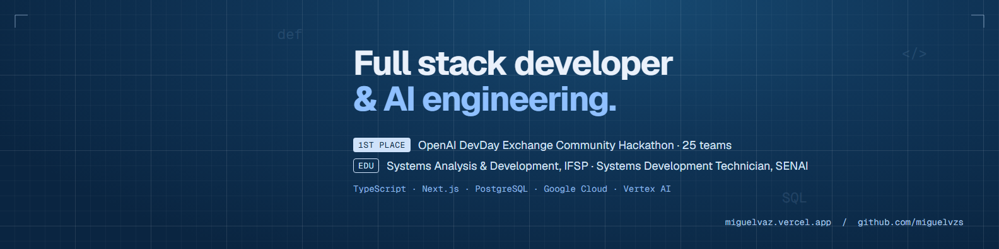

 

I'm a full stack developer from Extrema, Brazil. I take systems from the first conversation with the people who will use them to production: data model, API, interface, cloud, deploy and the AI pieces in between. Before software I worked in manufacturing R&D and operations, so I tend to build for the people on the floor, not for the demo.

 

### What I work on

<table>
<tr>
<td width="50%" valign="top">

**Product engineering** 
TypeScript end to end: Next.js and React on the front, Node.js with Fastify or Express on the back, PostgreSQL with Prisma underneath. Accessible interfaces (WCAG AA), role-based access, audit trails.

</td>
<td width="50%" valign="top">

**Cloud and delivery** 
Google Cloud with Terraform: Cloud Run, Cloud SQL, Secret Manager, load balancing. CI/CD on GitHub Actions with Workload Identity Federation, secret scanning, QA on every merge and gated production deploys. Production database migrations with rehearsal, checksums and rollback.

</td>
</tr>
<tr>
<td width="50%" valign="top">

**Applied AI** 
LLM pipelines that hold up in production: structured output validated with Zod, answers anchored to their source to catch hallucinations, a second model reviewing the first, confidence thresholds with human approval, and models picked by blind evaluation. Streaming transcription, document OCR, vision, MCP servers. Claude, Gemini and GPT through Vertex AI and OpenRouter.

</td>
<td width="50%" valign="top">

**Data and security** 
PostgreSQL modeled in raw, trusted and refined layers, row-level security and outbox-based integrations. Secrets only in a secret manager, no direct access to production data, LGPD from the first spec.

</td>
</tr>
</table>

 

### How I work

- **Spec before code.** Product, scope and security written in markdown first; decisions recorded as ADRs; open questions stay open instead of becoming guesses.
- **Tests as the contract.** Vitest and Playwright, 550+ automated tests across projects.
- **AI agents in the loop, with guardrails.** I build with Claude Code and Cursor; the spec, the tests and code review decide what ships.

 

### Projects

<table>
<tr>
<td width="50%" valign="top">

**[Quebra-Gelo](https://github.com/JulioAkaminee/devday-hackathon)** · 1st place, OpenAI hackathon · [demo](https://quebra-gelo.julioakamine.com) 
Won the OpenAI DevDay Exchange Community Hackathon out of 25 teams, run by the OpenAI Codex Ambassadors in São Paulo. A virtual pet that only moves forward when you meet someone for real: real-time multiplayer over WebSocket, pets generated by a multimodal model with structured output and an on-device fallback, and a live board for the organizers. 
TypeScript · Vite · Express · WebSocket · OpenRouter

</td>
<td width="50%" valign="top">

**[Morada](https://getmorada.app)** · in progress · [getmorada.app](https://getmorada.app) 
Mobile app for immigrants: money, who owes you, goals, document deadlines and a city community, in Portuguese, Spanish and English. 
Expo · React Native · Next.js · Prisma · PostgreSQL

</td>
</tr>
<tr>
<td width="50%" valign="top">

**[validador-registros-tabulares](https://github.com/miguelvzs/validador-registros-tabulares)** 
Validates spreadsheet records against business rules; an LLM agent rereads the rejects and recovers what it can. Exposed as an MCP server. 
Python · FastAPI · Pandas · Claude · MCP

</td>
<td width="50%" valign="top">

**[pipeline-tendencia-conteudo](https://github.com/miguelvzs/pipeline-tendencia-conteudo)** 
Trend to post with no human in the loop: signal capture, AI triage, art and video generation, TikTok publishing. 
Python · Claude · Docker · Fly.io

</td>
</tr>
<tr>
<td width="50%" valign="top">

**Media ops hub** · client work 
Internal system in production for a media company: screens, library, scheduling, contracts, billing and an AI assistant. 
Next.js 16 · Prisma · PostgreSQL · AI SDK

</td>
<td width="50%" valign="top">

**[vellfinancing](https://github.com/miguelvzs/vellfinancing)** 
Personal finance in pt-BR: transactions, budgets, goals, investments and OFX/CSV bank import. 
JavaScript · Drizzle · PostgreSQL

</td>
</tr>
</table>

Also: [site-crie](https://github.com/miguelvzs/site-crie) · [news card generator](https://noticiaskss.vercel.app) · [portfolio](https://github.com/miguelvzs/portfolio)

 

### Stack

| | |
|---|---|
| **Languages** | TypeScript, JavaScript, Python, SQL, C# |
| **Front end** | React, Next.js, Tailwind CSS, TanStack Query, Expo, three.js |
| **Back end** | Node.js, Fastify, Express, FastAPI, Prisma, Drizzle, Zod |
| **Data** | PostgreSQL, Cloud SQL, Redis |
| **Cloud and ops** | Google Cloud, Terraform, Docker, GitHub Actions, Vercel, Fly.io |
| **AI** | Vertex AI, Anthropic API, OpenRouter, AI SDK, MCP, Gemini Live |
| **Quality** | Vitest, Playwright, ESLint, accessibility (WCAG AA) |

 

### Background

- **Recognition:** 1st place, OpenAI DevDay Exchange Community Hackathon, São Paulo, 2026 (25 teams)
- **Education:** Systems Analysis and Development at IFSP (in progress) · Systems Development Technician at SENAI · technical drawing and electromechanical maintenance
- **Before software:** R&D at Soft Film, apprenticeships at Hutchinson and Panasonic

 

